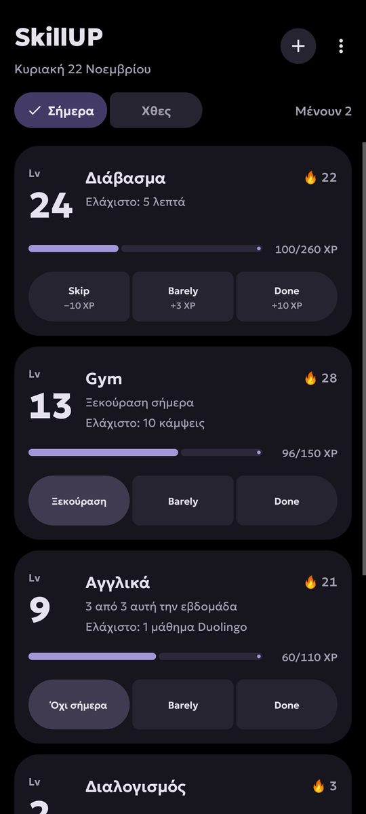
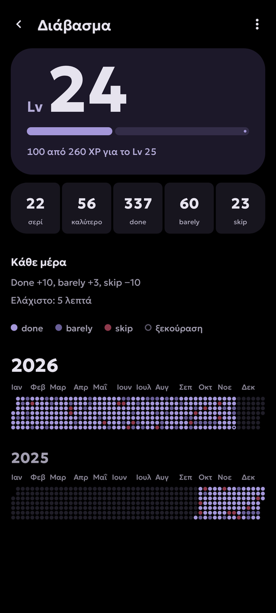

# SkillUP

Habit tracker με levels. Κάθε task είναι ένα skill: όταν το κάνεις ανεβαίνει, όταν το παραλείπεις πέφτει.
Ο στόχος είναι να μη μείνει καμία μέρα κενή. Ακόμα κι όταν δεν το κάνεις ολόκληρο, κάνεις τουλάχιστον το ελάχιστο.

 

## Εγκατάσταση

Κατέβασε το [`apk/SkillUP.apk`](apk/SkillUP.apk) στο κινητό και άνοιξέ το. Το Android θα ζητήσει να
επιτρέψεις «εγκατάσταση από άγνωστες πηγές» για την εφαρμογή από την οποία το άνοιξες (Chrome, Files κ.λπ.).

## Κανόνες

- Κάθε μέρα σημειώνεις για κάθε task **Done**, **Barely** (έκανες μόνο το ελάχιστο, π.χ. 5 λεπτά) ή **Skip**.
- Όσα δεν σημειώσεις μέχρι το τέλος της μέρας γίνονται αυτόματα **skip**. Μπορείς να αλλάξεις τη σημερινή
  και τη χθεσινή μέρα (κουμπί «Χθες»). Οι παλαιότερες μέρες κλειδώνουν.
- Για ένα καθημερινό task το done δίνει **+10 XP**, το barely **+3** και το skip **−10**. Όσο πιο σπάνια
  γίνεται ένα task, τόσο περισσότερο αξίζει κάθε φορά, ώστε μια τέλεια εβδομάδα να δίνει περίπου 70 XP
  (69 έως 72, γιατί κάθε φορά στρογγυλεύεται):

  | Πρόγραμμα | Done | Barely | Skip |
  |---|---|---|---|
  | Κάθε μέρα | +10 | +3 | −10 |
  | 5 μέρες / 5 φορές | +14 | +4 | −14 |
  | 3 μέρες / 3 φορές | +23 | +7 | −23 |
  | 1 μέρα / 1 φορά | +70 | +21 | −70 |

- **Levels:** για το Lv 2 θέλεις 30 XP, και κάθε επόμενο level θέλει 10 περισσότερα (40, 50, …). Με done κάθε μέρα
  φτάνεις στο Lv 10 σε περίπου 2 μήνες και στο Lv 20 σε περίπου 7,5 μήνες. Τα skip μπορούν να σε ρίξουν level,
  αλλά ποτέ κάτω από το Lv 1.
- **Ορισμένες μέρες** (π.χ. gym Δευ/Τετ/Παρ): τις υπόλοιπες μέρες έχεις «Ξεκούραση», που δεν δίνει XP και
  δεν σπάει το σερί. Αν το κάνεις και σε μέρα ξεκούρασης, σημειώνεται στον πίνακα χωρίς XP.
- **Φορές την εβδομάδα** (π.χ. 3/εβδ., όποιες μέρες θέλεις): κάθε φορά δίνει XP μέχρι να πιάσεις τον στόχο,
  και οι παραπάνω φορές δεν δίνουν XP. Την Κυριακή, όσες φορές λείπουν μετράνε ως skip (μπορείς να το διορθώσεις
  και τη Δευτέρα). Μια εβδομάδα που ξεκινάει στη μέση (νέο task) ζητάει ανάλογα λιγότερες φορές.
- **🔥 Σερί:** πόσες συνεχόμενες φορές το έκανες χωρίς skip.
- Αν αλλάξεις το πρόγραμμα ενός task, η αλλαγή ισχύει από σήμερα και μετά. Οι παλιές μέρες μένουν όπως ήταν.

### Tasks αποφυγής

Για κάτι που θέλεις να **μην** κάνεις (π.χ. «Όχι shorts»). Στο «Νέο task» διαλέγεις **Να αποφεύγω**.

- Ισχύουν κάθε μέρα. Μια μέρα είναι **καθαρή** αυτόματα, εκτός αν πατήσεις **Το έκανα**.
- Μια καθαρή μέρα δίνει **+10 XP**, που μπαίνει τα μεσάνυχτα. Ως τότε η σημερινή μέρα δείχνει «Καθαρό, +10 τα μεσάνυχτα».
- Το **Το έκανα** κοστίζει **−30 XP** αμέσως (μία υποτροπή = τρεις καθαρές μέρες). Αν το ξαναπατήσεις, αναιρείται.
  Όπως και στα άλλα tasks, μπορείς να το αλλάξεις σήμερα και χθες.
- Το 🔥 μετράει συνεχόμενες καθαρές μέρες. Εμφανίζονται σε ξεχωριστή ενότητα «Αποφεύγω» και δεν μετράνε στο «Μένουν N»
  ούτε στη βραδινή υπενθύμιση.
- Ο τύπος (να κάνω / να αποφεύγω) επιλέγεται μόνο στη δημιουργία, γιατί αλλάζει το τι σημαίνει κάθε μέρα του ιστορικού.

## Χρήση

- **+** πάνω δεξιά: νέο task με όνομα, ελάχιστο (προαιρετικά) και πρόγραμμα.
- Πατάς ένα κουμπί για να σημειώσεις τη μέρα, και το ξαναπατάς για να το αναιρέσεις.
- Πατώντας ένα task ανοίγει η σελίδα του: level, στατιστικά και ένας πίνακας με κουκκίδες ανά χρονιά.
  Από το **⋮** εκεί κάνεις επεξεργασία ή διαγραφή.
- **⋮** στην αρχική:
  - **Υπενθύμιση:** μία βραδινή ειδοποίηση (21:00 από προεπιλογή), μόνο αν έχεις ακόμα κάτι για σήμερα.
  - **Εξαγωγή backup / Εισαγωγή backup:** ένα αρχείο `.json` που κρατάς όπου θέλεις (Drive, Downloads).

Τα δεδομένα μένουν στο κινητό (`files/skillup.json`). Αν το κινητό κάνει αυτόματο backup στο Google, αντίγραφό τους
μπαίνει κι εκεί. Πριν από αλλαγή κινητού ή απεγκατάσταση, κάνε εξαγωγή backup.

## Build

```sh
export SKILLUP_KEYSTORE=/path/to/skillup-release.p12 SKILLUP_KEYSTORE_PASS=...
./build.sh   # τρέχει πρώτα τα tests (test/EngineTest.java: κανόνες και αρχείο δεδομένων) -> build/SkillUP.apk
```

Δεν χρειάζεται Android SDK ή Gradle: το script κατεβάζει από το Maven Central τα aapt2 (apktool),
android-all (Robolectric), dx και apksig, και ελέγχει το SHA-256 του καθενός. Χρειάζεται Linux x86-64, JDK 17+,
python3, curl, unzip και sha256sum. Αν το Maven Central απαντήσει `429`, ξανατρέξε το script: ό,τι κατέβηκε ήδη
μένει στο `.tools/`.

Το κλειδί υπογραφής **δεν** είναι σε αυτό το repo: το `build.sh` το διαβάζει από το `SKILLUP_KEYSTORE` (αρχείο PKCS12,
alias `skillup`) και τον κωδικό του από το `SKILLUP_KEYSTORE_PASS`. Κράτα το ίδιο κλειδί, ώστε οι νέες εκδόσεις
να εγκαθίστανται πάνω στην παλιά χωρίς να χαθούν τα δεδομένα. Για νέα έκδοση ανέβασε το `VERSION_CODE` στο `build.sh`.

Οι κανόνες (XP, levels, σερί, εβδομαδιαία εκκαθάριση) βρίσκονται όλοι στο `Engine.java`, σε καθαρή Java χωρίς Android.

Γραμματοσειρά: [Geologica](https://github.com/monokromskriftforlag/geologisk) (SIL Open Font License 1.1, κείμενο στο
`app/src/main/res/raw/ofl_geologica.txt`), σε στατικά βάρη 400/500/600/800 με τον άξονα «sharpness» στο 0, μόνο λατινικά και ελληνικά.
